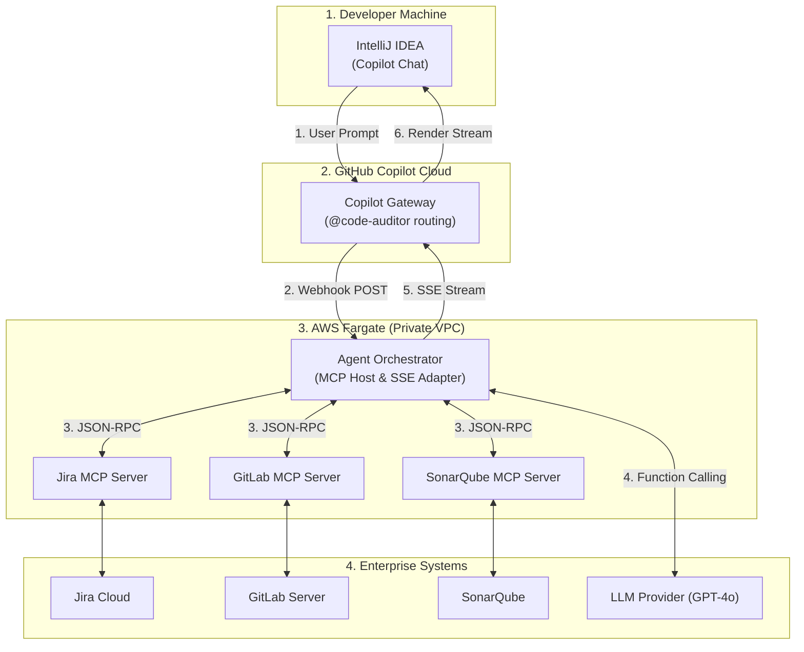
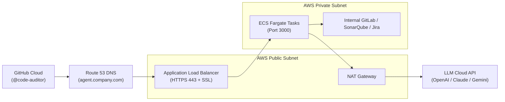

# Enterprise Code Auditor Agent: System Design & Implementation with MCP (Model Context Protocol)

---

## 1. Executive Summary & Architecture

This document details the production-grade architecture, implementation, and end-to-end software development lifecycle (SDLC) for an **Enterprise Code Auditor Agent**. 

The system leverages **Model Context Protocol (MCP)** as a standardized abstraction layer connecting an IDE (IntelliJ IDEA via GitHub Copilot) to enterprise developer platforms (**Jira, GitLab, SonarQube, and Semgrep**).

> **Viewing in IntelliJ IDEA?**  
> If Mermaid diagrams show as raw text, enable IntelliJ's built-in Mermaid renderer:  
> Go to **Settings/Preferences (`Cmd + ,`)** → **Languages & Frameworks** → **Markdown** → enable **Mermaid** (or install the free JetBrains **Mermaid** plugin).  
> *Universal visual ASCII diagrams are also provided below for guaranteed visibility in any viewer.*

---

### High-Level System Architecture Diagram

```
+---------------------------------------------------------------------------------------+
|  DEVELOPER WORKSTATION                                                                |
|  IntelliJ IDEA (GitHub Copilot Chat)                                                  |
|  Prompt: "@code-auditor Review my local method against PAY-204"                       |
+-------------------------------------------+-------------------------------------------+
                                            |
                         1. Prompts Agent   |   6. Real-Time Token Stream (SSE)
                                            v
+---------------------------------------------------------------------------------------+
|  GITHUB COPILOT CLOUD (Routing Gateway)                                               |
|  Matches @code-auditor -> Forwards webhook HTTP POST to registered AWS URL            |
+-------------------------------------------+-------------------------------------------+
                                            |
                   2. Webhook Forwarding    |   5. SSE Chunks ("data: { choices: ... }")
                                            v
+---------------------------------------------------------------------------------------+
|  AWS ECS ON FARGATE (Your Enterprise VPC Private Subnet)                              |
|                                                                                       |
|  +---------------------------------------------------------------------------------+  |
|  | AGENT ORCHESTRATOR SERVICE (Express.js + MCP Client Host)                       |  |
|  | - Listens on /agent (Receives prompt + code context)                            |  |
|  | - Autonomous Tool-Calling Loop with LLM (OpenAI / Gemini / Claude)              |  |
|  +----------------------------------------+----------------------------------------+  |
|                                           |                                           |
|                   3. MCP Protocol         |   3. Tool Responses                       |
|                   (JSON-RPC 2.0)          |   (Standardized Schema)                   |
|                                           v                                           |
|  +---------------------------------------------------------------------------------+  |
|  | ENTERPRISE MCP SERVERS (Standardized Tool Abstraction Layer)                    |  |
|  |                                                                                 |  |
|  |  [ Jira MCP Server ]      [ GitLab MCP Server ]     [ SonarQube MCP Server ]    |  |
|  |  (Fetches criteria)       (Fetches MR diffs)        (Fetches smells & gates)    |  |
|  +-------------+--------------------------+--------------------------+-------------+  |
+----------------|--------------------------|--------------------------|----------------+
                 |                          |                          |
                 v                          v                          v
      [ Jira Cloud / DC ]          [ GitLab Enterprise ]       [ SonarQube Server ]
```



---

## 2. End-to-End Workflow: From Local Code to Merge Request (MR)

This workflow maps how the agent aids a software engineer during the delivery of a feature ticket (e.g., `PAY-204: Add exponential backoff retry to PaymentService`).

```
PHASE 1: LOCAL PRE-COMMIT AUDIT (IntelliJ)
  Developer prompts: "@code-auditor Review my local method against PAY-204"
        │
        ├──► Agent queries Jira MCP (Reads acceptance criteria & retry limits)
        ├──► Agent queries Semgrep MCP (Runs static check on snippet)
        └──► Streams bug diagnosis: Flags non-thread-safe state & provides fix
  Developer applies fix with verified behavior parity.

PHASE 2: COMMIT & MR CREATION
  Developer prompts: "@code-auditor Generate GitLab MR description"
        │
        └──► Agent outputs formatted description with test checklist
  Developer commits & pushes branch to GitLab: git push origin feature/PAY-204
  Developer creates GitLab Merge Request (MR).

PHASE 3: GITLAB CI PIPELINE RUNS (The Repo-Wide Safety Net)
  GitLab CI executes multi-stage pipeline:
  Stage 1: Compile & Unit Tests (mvn test / npm test)
  Stage 2: SonarQube Static Analysis & Quality Gate
  Stage 3: Integration Tests (Testcontainers / Database)
        │
        └──► ❌ CI Pipeline Fails (e.g., Build broken / Quality gate violated)

PHASE 4: POST-PUSH TRIAGE & REMEDIATION VIA GITLAB & SONAR MCP (IntelliJ)
  Developer prompts: "@code-auditor Why did my GitLab CI pipeline fail? Fix it."
        │
        ├──► Agent queries GitLab MCP:
        │     - Calls gitlab.get_pipeline_jobs() -> Identifies failed job: 'mvn-test'
        │     - Calls gitlab.get_job_log() -> Extracts terminal stacktrace & failed tests
        ├──► Agent queries SonarQube MCP:
        │     - Calls sonar.get_issues() -> Fetches code smells & missing coverage
        └──► Streams exact diagnosis & code fix directly into IntelliJ chat!
  Developer applies fix, commits & pushes: git commit -am "fix: resolve CI failure" && git push
  GitLab CI re-runs: ✅ All Stages Turn Green!

PHASE 5: AUTOMATED VERIFICATION & MR MERGE
  MR is approved with full audit trail and merged into main.
```

---

### The "Enterprise MCP Trio": How the Pieces Fit Together

```
+---------------------------------------------------------------------------------------+
|                               INTELLIJ COPILOT AGENT                                  |
|                                                                                       |
|   +-----------------------+   +-----------------------+   +-----------------------+   |
|   |    JIRA MCP SERVER    |   |   GITLAB MCP SERVER   |   |  SONARQUBE MCP SERVER |   |
|   +-----------+-----------+   +-----------+-----------+   +-----------+-----------+   |
+---------------|---------------------------|---------------------------|---------------+
                |                           |                           |
                v                           v                           v
      "WHAT should I build?"       "DID the build pass?       "IS the code clean,
       - Requirements & specs       What broke in CI?"         secure & well-tested?"
       - Acceptance criteria        - Pipeline status & jobs   - Quality Gates
       - Edge cases to cover        - Raw job terminal logs    - Code smell details
                                    - MR diffs & comments      - Coverage percentages
```

---

### Why Does Phase 3 Fail If Phase 1 Already Passed?

A common question: *"If `@code-auditor` reviewed my code in Phase 1, why would the build ever fail in Phase 3?"*

**Phase 1 is a micro-level local audit** (inspecting active files/methods). **Phase 3 is a macro-level system integration** across the entire repository. The table below details why Phase 3 acts as the ultimate safety net:

| Failure Scenario in Phase 3 | Why Local Phase 1 Didn't Catch It | How Phase 4 (GitLab & Sonar MCP) Resolves It |
| :--- | :--- | :--- |
| **1. Missing Code Coverage** | Phase 1 checked logic correctness, but you forgot to write new unit tests. SonarQube requires $\ge 80\%$ coverage on new code. | Sonar MCP reports the uncovered branches; Agent automatically generates the missing JUnit/Mock tests. |
| **2. Cross-Module Breaking Change** | You changed a method signature in `PaymentService.java`. Phase 1 only saw your file, but `OrderController.java` elsewhere in the repo now fails to compile. | GitLab MCP inspects the `mvn compile` log, points out `OrderController.java:88`, and updates the caller. |
| **3. Integration Test Failures** | Heavy integration tests (Postgres, Kafka, Docker) only run in CI. A foreign key constraint or DB migration script failed. | GitLab MCP reads the terminal stacktrace from `get_job_log()` and explains the exact database constraint violation. |
| **4. Third-Party CVE Vulnerabilities** | You added an external library in `pom.xml`. Security scanners (Snyk/Semgrep) in CI block the pipeline due to a critical CVE. | GitLab/Semgrep MCP flags the vulnerable dependency and suggests an upgraded, non-vulnerable version. |
| **5. Branch Outdated vs. `main`** | Teammates merged code into `main` while you were working. GitLab CI tests your branch against the latest target branch. | GitLab MCP detects the contract conflict and guides conflict resolution. |

---


---

## 3. Production-Grade Implementation (TypeScript + MCP SDK)

### `package.json`
```json
{
  "name": "enterprise-code-auditor-mcp",
  "version": "1.0.0",
  "type": "module",
  "scripts": {
    "build": "tsc",
    "start": "node dist/server.js",
    "dev": "tsx watch src/server.ts"
  },
  "dependencies": {
    "@modelcontextprotocol/sdk": "^0.6.0",
    "dotenv": "^16.4.5",
    "express": "^4.19.2",
    "openai": "^4.56.0"
  },
  "devDependencies": {
    "@types/express": "^4.17.21",
    "@types/node": "^22.0.0",
    "tsx": "^4.16.2",
    "typescript": "^5.5.4"
  }
}
```

---

### `src/server.ts` (The Complete MCP Orchestrator)

```typescript
import express, { Request, Response } from 'express';
import dotenv from 'dotenv';
import OpenAI from 'openai';
import { Client } from '@modelcontextprotocol/sdk/client/index.js';
import { StdioClientTransport } from '@modelcontextprotocol/sdk/client/stdio.js';

dotenv.config();

const app = express();
app.use(express.json({ limit: '10mb' }));

const openai = new OpenAI({ apiKey: process.env.OPENAI_API_KEY });

// -----------------------------------------------------------------------------
// 1. MCP Client Manager: Connect to Standardized MCP Servers
// -----------------------------------------------------------------------------
interface RegisteredServer {
  name: string;
  client: Client;
  tools: any[];
}

const activeServers: Map<string, RegisteredServer> = new Map();

async function connectToMCPServer(name: string, command: string, args: string[], envVars: Record<string, string> = {}) {
  try {
    const transport = new StdioClientTransport({
      command,
      args,
      env: { ...process.env, ...envVars },
    });

    const client = new Client({ name: `copilot-orchestrator-${name}`, version: '1.0.0' }, { capabilities: {} });
    await client.connect(transport);

    const toolsResult = await client.listTools();
    const mappedTools = toolsResult.tools.map((t) => ({
      type: 'function',
      function: {
        name: `${name}__${t.name}`,
        description: `[From ${name}] ${t.description}`,
        parameters: t.inputSchema,
      },
    }));

    activeServers.set(name, { name, client, tools: mappedTools });
    console.log(`[MCP] Connected to ${name} server with ${mappedTools.length} tools.`);
  } catch (error: any) {
    console.error(`[MCP] Failed to connect to ${name} server:`, error.message);
  }
}

// Initialize connections to official/open-source MCP Servers
async function initMCPEcosystem() {
  // 1. Jira MCP Server
  await connectToMCPServer('jira', 'npx', ['-y', '@atlassian/jira-mcp-server'], {
    JIRA_HOST: process.env.JIRA_HOST || '',
    JIRA_EMAIL: process.env.JIRA_EMAIL || '',
    JIRA_API_TOKEN: process.env.JIRA_API_TOKEN || '',
  });

  // 2. GitLab MCP Server
  await connectToMCPServer('gitlab', 'npx', ['-y', '@modelcontextprotocol/server-gitlab'], {
    GITLAB_API_URL: process.env.GITLAB_API_URL || 'https://gitlab.com',
    GITLAB_PERSONAL_ACCESS_TOKEN: process.env.GITLAB_PERSONAL_TOKEN || '',
  });

  // 3. SonarQube Custom/Community MCP Server
  await connectToMCPServer('sonar', 'node', ['./dist/servers/sonar-mcp.js'], {
    SONARQUBE_URL: process.env.SONARQUBE_URL || '',
    SONARQUBE_TOKEN: process.env.SONARQUBE_TOKEN || '',
  });
}

// -----------------------------------------------------------------------------
// 2. Dynamic Tool Calling Execution Engine
// -----------------------------------------------------------------------------
async function executeMCPTool(namespacedToolName: string, args: any): Promise<string> {
  const [serverName, originalToolName] = namespacedToolName.split('__');
  const server = activeServers.get(serverName);

  if (!server) {
    throw new Error(`MCP Server '${serverName}' is not registered or unavailable.`);
  }

  const result = await server.client.callTool({
    name: originalToolName,
    arguments: args,
  });

  if (Array.isArray(result.content)) {
    return result.content.map((c: any) => c.text || JSON.stringify(c)).join('\n');
  }
  return JSON.stringify(result.content);
}

// -----------------------------------------------------------------------------
// 3. Copilot Extension HTTP & SSE Webhook Endpoint
// -----------------------------------------------------------------------------
app.post('/agent', async (req: Request, res: Response): Promise<void> => {
  const { messages } = req.body;

  // Initialize Server-Sent Events (SSE) Stream
  res.setHeader('Content-Type', 'text/event-stream');
  res.setHeader('Cache-Control', 'no-cache');
  res.setHeader('Connection', 'keep-alive');

  const sendSSEChunk = (text: string) => {
    res.write(`data: ${JSON.stringify({ choices: [{ delta: { content: text } }] })}\n\n`);
  };

  try {
    sendSSEChunk('🔍 *Connecting to MCP Orchestrator & checking available tools...*\n\n');

    // Collect all tools exposed by registered MCP servers
    const allTools = Array.from(activeServers.values()).flatMap((s) => s.tools);

    const systemPrompt = `
You are the **Senior Enterprise Code Reviewer & Bug Auditor**.
Your environment uses GitLab for source control, Jira for specifications, and SonarQube for static analysis.

You have dynamic access to external tools via the **Model Context Protocol (MCP)**:
- **Jira MCP:** Call Jira tools to fetch ticket acceptance criteria, story requirements, and edge cases.
- **GitLab MCP:** Call GitLab tools to inspect Merge Requests, fetch pipeline statuses (`get_pipeline_jobs`), and pull raw terminal logs (`get_job_log` / `get_job_trace`) when a CI build fails.
- **SonarQube MCP:** Call Sonar tools to look up open bugs, cognitive complexity violations, security hotspots, and quality gate metrics.

### Instructions:
1. When asked to audit code, invoke the necessary MCP tools autonomously.
2. If the user mentions a failed CI pipeline or build, query GitLab MCP for the failing job, extract the terminal stacktrace, and diagnose the root cause.
3. Cross-reference code implementation with Jira requirements.
4. Guarantee strict **behavior parity** on any suggested refactoring.
5. Provide structured, production-ready solutions with verification plans.
`;

    let currentMessages: any[] = [
      { role: 'system', content: systemPrompt },
      ...messages,
    ];

    // Autonomous Tool Execution Loop (up to 5 iterations)
    let iterations = 0;
    while (iterations < 5) {
      iterations++;

      const completion = await openai.chat.completions.create({
        model: process.env.LLM_MODEL || 'gpt-4o',
        messages: currentMessages,
        tools: allTools.length > 0 ? allTools : undefined,
        tool_choice: 'auto',
      });

      const responseMessage = completion.choices[0].message;

      // Check if the LLM decided to invoke one or more MCP tools
      if (responseMessage.tool_calls && responseMessage.tool_calls.length > 0) {
        currentMessages.push(responseMessage);

        for (const toolCall of responseMessage.tool_calls) {
          const toolName = toolCall.function.name;
          const toolArgs = JSON.parse(toolCall.function.arguments);

          sendSSEChunk(`⚙️ *Executing tool:* \`${toolName}\`...\n\n`);

          let toolOutput: string;
          try {
            toolOutput = await executeMCPTool(toolName, toolArgs);
          } catch (err: any) {
            toolOutput = `Error calling tool ${toolName}: ${err.message}`;
          }

          currentMessages.push({
            role: 'tool',
            tool_call_id: toolCall.id,
            content: toolOutput,
          });
        }
        // Loop again to allow LLM to inspect tool responses
        continue;
      }

      // No more tool calls needed. Stream final synthesis to IntelliJ
      const stream = await openai.chat.completions.create({
        model: process.env.LLM_MODEL || 'gpt-4o',
        messages: currentMessages,
        stream: true,
      });

      for await (const chunk of stream) {
        const content = chunk.choices[0]?.delta?.content || '';
        if (content) sendSSEChunk(content);
      }
      break;
    }

    res.write('data: [DONE]\n\n');
    res.end();
  } catch (error: any) {
    console.error('Agent Orchestration Error:', error);
    sendSSEChunk(`\n\n❌ **Audit Failed:** ${error.message}`);
    res.write('data: [DONE]\n\n');
    res.end();
  }
});

// Start Server
const PORT = process.env.PORT || 3000;
app.listen(PORT, async () => {
  console.log(`Enterprise Code Auditor (MCP Host) active on port ${PORT}`);
  await initMCPEcosystem();
});
```

---

## 4. AWS Production Deployment Architecture

```
[ GitHub Cloud Gateway ]
           │
           │ HTTPS (Route 53: agent.company.com)
           ▼
[ Application Load Balancer (ALB) ]  <-- In AWS Public Subnet (Port 443 + ACM SSL)
           │
           │ Forward to Target Group (Port 3000)
           ▼
+----------------------------------------------------------------------------+
| AWS VPC PRIVATE SUBNETS                                                    |
|                                                                            |
|  [ ECS Fargate Container Tasks ]                                           |
|  - Runs Node.js / Express Server on Port 3000                              |
|  - Speaks MCP to Jira, GitLab, and SonarQube                               |
|                                                                            |
|         │                                          │                       |
|         ├── (Outbound via NAT Gateway)             ├── (Direct Private IPs)|
|         ▼                                          ▼                       |
|  [ Public LLM API ]                         [ Internal Enterprise Tools ]  |
|  (OpenAI GPT-4o / Claude / Gemini)          - Internal GitLab Server       |
|                                             - Internal SonarQube Server    |
|                                             - Jira Cloud / Data Center     |
+----------------------------------------------------------------------------+
```



### Why AWS ECS on Fargate over AWS Lambda?

| Engineering Consideration | AWS ECS on Fargate | AWS Lambda + API Gateway |
| :--- | :--- | :--- |
| **HTTP Streaming (SSE)** | Native chunked transfer support via Application Load Balancer. | Buffers responses by default; requires complex Lambda Function URL setup. |
| **Timeout Constraints** | No practical limit (ideal for multi-step audits taking 30–60s). | Hard 29-second execution limit on API Gateway. |
| **Child Process Spawning** | Supported (can run local Stdio MCP server binaries via `npx`). | Severely restricted filesystem and process execution environment. |
| **Cold Starts** | Zero. Always warm container instances. | 2–6 second latency spikes during cold starts. |

---

## 5. System Design Interview Cheatsheet (Q&A)

### Q: Why Model Context Protocol (MCP) instead of direct REST API clients?
> **Answer:** "Direct REST integrations create an $O(N \times M)$ integration bottleneck—every agent framework must rewrite custom HTTP wrappers, authentication, and serialization logic for every domain service.
> 
> By introducing **MCP**, we decouple the **Orchestrator (MCP Host)** from the **Domain Capabilities (MCP Servers)**. The LLM receives standard JSON Schema definitions and autonomously selects tools through function calling. When new tools are introduced (e.g., Datadog, Snyk, or PostgreSQL), we register their respective MCP servers without writing a single line of custom client code in the agent."

### Q: How does the agent handle streaming while executing tools?
> **Answer:** "We use a hybrid multi-turn orchestration loop. When the model invokes a tool call, we send an immediate Server-Sent Event (SSE) progress indicator (`⚙️ Executing tool: jira__get_issue...`) back to IntelliJ so the user has immediate feedback. Once all tool executions resolve, the final synthesis is streamed token-by-token directly to the IDE using standard SSE framing (`data: { choices: [{ delta: { content: ... } }] }`)."

### Q: How is behavior parity guaranteed during code refactoring?
> **Answer:** "The agent's system prompt strictly enforces behavioral invariance: inputs, outputs, exceptions, and side effects must remain functionally identical. Furthermore, the agent generates regression unit tests covering edge cases identified during static analysis to mathematically prove behavior parity before human merge."

### Q: How does the agent triage and resolve GitLab CI pipeline failures without the developer opening a browser?
> **Answer:** "The agent acts as an MCP Host connected to the official GitLab MCP Server. When a developer asks about a broken pipeline, the LLM calls `gitlab__get_pipeline_jobs` to identify the failing job, followed by `gitlab__get_job_log` (or `get_job_trace`) to extract the terminal logs and stacktrace.
> 
> The LLM correlates this CI error with the active code open in IntelliJ, isolates the root cause (such as an unmocked integration call or compilation failure), and streams a drop-in code fix directly into the IDE chat."
