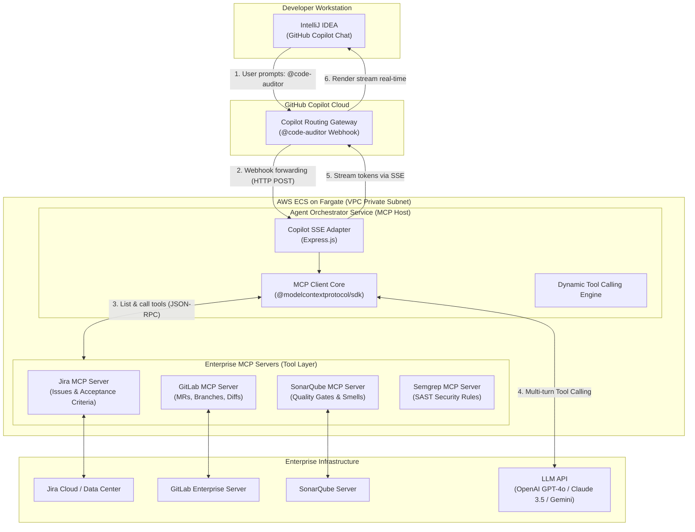
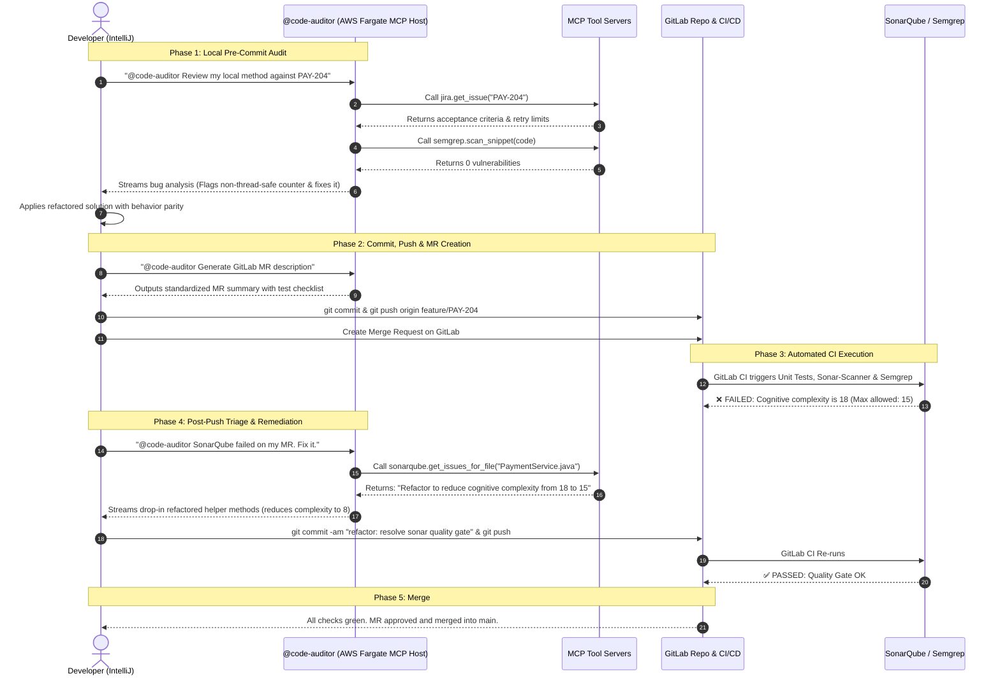
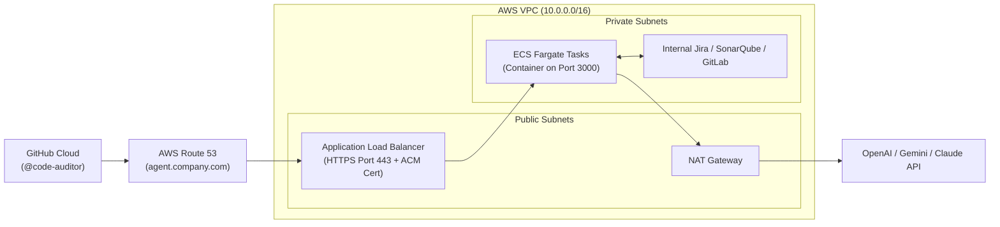

# Enterprise Code Auditor Agent: System Design & Implementation with MCP (Model Context Protocol)

---

## 1. Executive Summary & Architecture

This document details the production-grade architecture, implementation, and end-to-end software development lifecycle (SDLC) for an **Enterprise Code Auditor Agent**. 

The system leverages **Model Context Protocol (MCP)** as a standardized abstraction layer connecting an IDE (IntelliJ IDEA via GitHub Copilot) to enterprise developer platforms (**Jira, GitLab, SonarQube, and Semgrep**).

### High-Level System Architecture



---

## 2. End-to-End Workflow: From Local Code to Merge Request (MR)

This workflow maps how the agent aids a software engineer during the delivery of a feature ticket (e.g., `PAY-204: Add exponential backoff retry to PaymentService`).



---

## 3. Production-Grade Implementation (TypeScript + MCP SDK)

### `package.json`
```json
{
  "name": "enterprise-code-auditor-mcp",
  "version": "1.0.0",
  "type": "module",
  "scripts": {
    "build": "tsc",
    "start": "node dist/server.js",
    "dev": "tsx watch src/server.ts"
  },
  "dependencies": {
    "@modelcontextprotocol/sdk": "^0.6.0",
    "dotenv": "^16.4.5",
    "express": "^4.19.2",
    "openai": "^4.56.0"
  },
  "devDependencies": {
    "@types/express": "^4.17.21",
    "@types/node": "^22.0.0",
    "tsx": "^4.16.2",
    "typescript": "^5.5.4"
  }
}
```

---

### `src/server.ts` (The Complete MCP Orchestrator)

```typescript
import express, { Request, Response } from 'express';
import dotenv from 'dotenv';
import OpenAI from 'openai';
import { Client } from '@modelcontextprotocol/sdk/client/index.js';
import { StdioClientTransport } from '@modelcontextprotocol/sdk/client/stdio.js';

dotenv.config();

const app = express();
app.use(express.json({ limit: '10mb' }));

const openai = new OpenAI({ apiKey: process.env.OPENAI_API_KEY });

// -----------------------------------------------------------------------------
// 1. MCP Client Manager: Connect to Standardized MCP Servers
// -----------------------------------------------------------------------------
interface RegisteredServer {
  name: string;
  client: Client;
  tools: any[];
}

const activeServers: Map<string, RegisteredServer> = new Map();

async function connectToMCPServer(name: string, command: string, args: string[], envVars: Record<string, string> = {}) {
  try {
    const transport = new StdioClientTransport({
      command,
      args,
      env: { ...process.env, ...envVars },
    });

    const client = new Client({ name: `copilot-orchestrator-${name}`, version: '1.0.0' }, { capabilities: {} });
    await client.connect(transport);

    const toolsResult = await client.listTools();
    const mappedTools = toolsResult.tools.map((t) => ({
      type: 'function',
      function: {
        name: `${name}__${t.name}`,
        description: `[From ${name}] ${t.description}`,
        parameters: t.inputSchema,
      },
    }));

    activeServers.set(name, { name, client, tools: mappedTools });
    console.log(`[MCP] Connected to ${name} server with ${mappedTools.length} tools.`);
  } catch (error: any) {
    console.error(`[MCP] Failed to connect to ${name} server:`, error.message);
  }
}

// Initialize connections to official/open-source MCP Servers
async function initMCPEcosystem() {
  // 1. Jira MCP Server
  await connectToMCPServer('jira', 'npx', ['-y', '@atlassian/jira-mcp-server'], {
    JIRA_HOST: process.env.JIRA_HOST || '',
    JIRA_EMAIL: process.env.JIRA_EMAIL || '',
    JIRA_API_TOKEN: process.env.JIRA_API_TOKEN || '',
  });

  // 2. GitLab MCP Server
  await connectToMCPServer('gitlab', 'npx', ['-y', '@modelcontextprotocol/server-gitlab'], {
    GITLAB_API_URL: process.env.GITLAB_API_URL || 'https://gitlab.com',
    GITLAB_PERSONAL_ACCESS_TOKEN: process.env.GITLAB_PERSONAL_TOKEN || '',
  });

  // 3. SonarQube Custom/Community MCP Server
  await connectToMCPServer('sonar', 'node', ['./dist/servers/sonar-mcp.js'], {
    SONARQUBE_URL: process.env.SONARQUBE_URL || '',
    SONARQUBE_TOKEN: process.env.SONARQUBE_TOKEN || '',
  });
}

// -----------------------------------------------------------------------------
// 2. Dynamic Tool Calling Execution Engine
// -----------------------------------------------------------------------------
async function executeMCPTool(namespacedToolName: string, args: any): Promise<string> {
  const [serverName, originalToolName] = namespacedToolName.split('__');
  const server = activeServers.get(serverName);

  if (!server) {
    throw new Error(`MCP Server '${serverName}' is not registered or unavailable.`);
  }

  const result = await server.client.callTool({
    name: originalToolName,
    arguments: args,
  });

  if (Array.isArray(result.content)) {
    return result.content.map((c: any) => c.text || JSON.stringify(c)).join('\n');
  }
  return JSON.stringify(result.content);
}

// -----------------------------------------------------------------------------
// 3. Copilot Extension HTTP & SSE Webhook Endpoint
// -----------------------------------------------------------------------------
app.post('/agent', async (req: Request, res: Response): Promise<void> => {
  const { messages } = req.body;

  // Initialize Server-Sent Events (SSE) Stream
  res.setHeader('Content-Type', 'text/event-stream');
  res.setHeader('Cache-Control', 'no-cache');
  res.setHeader('Connection', 'keep-alive');

  const sendSSEChunk = (text: string) => {
    res.write(`data: ${JSON.stringify({ choices: [{ delta: { content: text } }] })}\n\n`);
  };

  try {
    sendSSEChunk('🔍 *Connecting to MCP Orchestrator & checking available tools...*\n\n');

    // Collect all tools exposed by registered MCP servers
    const allTools = Array.from(activeServers.values()).flatMap((s) => s.tools);

    const systemPrompt = `
You are the **Senior Enterprise Code Reviewer & Bug Auditor**.
Your environment uses GitLab for source control, Jira for specifications, and SonarQube for static analysis.

You have dynamic access to external tools via the **Model Context Protocol (MCP)**:
- Call Jira tools to fetch ticket acceptance criteria when an issue key is referenced.
- Call SonarQube tools to look up open bugs, smells, or quality gate status.
- Call GitLab tools to view MR diffs or repository context.

### Instructions:
1. When asked to audit code, invoke the necessary MCP tools autonomously.
2. Cross-reference code implementation with Jira requirements.
3. Guarantee strict **behavior parity** on any suggested refactoring.
4. Provide structured, production-ready solutions with verification plans.
`;

    let currentMessages: any[] = [
      { role: 'system', content: systemPrompt },
      ...messages,
    ];

    // Autonomous Tool Execution Loop (up to 5 iterations)
    let iterations = 0;
    while (iterations < 5) {
      iterations++;

      const completion = await openai.chat.completions.create({
        model: process.env.LLM_MODEL || 'gpt-4o',
        messages: currentMessages,
        tools: allTools.length > 0 ? allTools : undefined,
        tool_choice: 'auto',
      });

      const responseMessage = completion.choices[0].message;

      // Check if the LLM decided to invoke one or more MCP tools
      if (responseMessage.tool_calls && responseMessage.tool_calls.length > 0) {
        currentMessages.push(responseMessage);

        for (const toolCall of responseMessage.tool_calls) {
          const toolName = toolCall.function.name;
          const toolArgs = JSON.parse(toolCall.function.arguments);

          sendSSEChunk(`⚙️ *Executing tool:* \`${toolName}\`...\n\n`);

          let toolOutput: string;
          try {
            toolOutput = await executeMCPTool(toolName, toolArgs);
          } catch (err: any) {
            toolOutput = `Error calling tool ${toolName}: ${err.message}`;
          }

          currentMessages.push({
            role: 'tool',
            tool_call_id: toolCall.id,
            content: toolOutput,
          });
        }
        // Loop again to allow LLM to inspect tool responses
        continue;
      }

      // No more tool calls needed. Stream final synthesis to IntelliJ
      const stream = await openai.chat.completions.create({
        model: process.env.LLM_MODEL || 'gpt-4o',
        messages: currentMessages,
        stream: true,
      });

      for await (const chunk of stream) {
        const content = chunk.choices[0]?.delta?.content || '';
        if (content) sendSSEChunk(content);
      }
      break;
    }

    res.write('data: [DONE]\n\n');
    res.end();
  } catch (error: any) {
    console.error('Agent Orchestration Error:', error);
    sendSSEChunk(`\n\n❌ **Audit Failed:** ${error.message}`);
    res.write('data: [DONE]\n\n');
    res.end();
  }
});

// Start Server
const PORT = process.env.PORT || 3000;
app.listen(PORT, async () => {
  console.log(`Enterprise Code Auditor (MCP Host) active on port ${PORT}`);
  await initMCPEcosystem();
});
```

---

## 4. AWS Production Deployment Architecture



### Why AWS ECS on Fargate over AWS Lambda?

| Engineering Consideration | AWS ECS on Fargate | AWS Lambda + API Gateway |
| :--- | :--- | :--- |
| **HTTP Streaming (SSE)** | Native chunked transfer support via Application Load Balancer. | Buffers responses by default; requires complex Lambda Function URL setup. |
| **Timeout Constraints** | No practical limit (ideal for multi-step audits taking 30–60s). | Hard 29-second execution limit on API Gateway. |
| **Child Process Spawning** | Supported (can run local Stdio MCP server binaries via `npx`). | Severely restricted filesystem and process execution environment. |
| **Cold Starts** | Zero. Always warm container instances. | 2–6 second latency spikes during cold starts. |

---

## 5. System Design Interview Cheatsheet (Q&A)

### Q: Why Model Context Protocol (MCP) instead of direct REST API clients?
> **Answer:** "Direct REST integrations create an $O(N \times M)$ integration bottleneck—every agent framework must rewrite custom HTTP wrappers, authentication, and serialization logic for every domain service.
> 
> By introducing **MCP**, we decouple the **Orchestrator (MCP Host)** from the **Domain Capabilities (MCP Servers)**. The LLM receives standard JSON Schema definitions and autonomously selects tools through function calling. When new tools are introduced (e.g., Datadog, Snyk, or PostgreSQL), we register their respective MCP servers without writing a single line of custom client code in the agent."

### Q: How does the agent handle streaming while executing tools?
> **Answer:** "We use a hybrid multi-turn orchestration loop. When the model invokes a tool call, we send an immediate Server-Sent Event (SSE) progress indicator (`⚙️ Executing tool: jira__get_issue...`) back to IntelliJ so the user has immediate feedback. Once all tool executions resolve, the final synthesis is streamed token-by-token directly to the IDE using standard SSE framing (`data: { choices: [{ delta: { content: ... } }] }`)."

### Q: How is behavior parity guaranteed during code refactoring?
> **Answer:** "The agent's system prompt strictly enforces behavioral invariance: inputs, outputs, exceptions, and side effects must remain functionally identical. Furthermore, the agent generates regression unit tests covering edge cases identified during static analysis to mathematically prove behavior parity before human merge."
