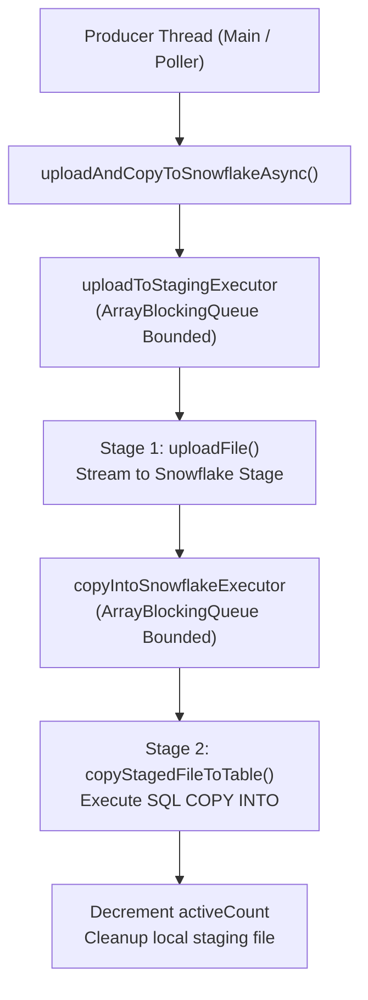
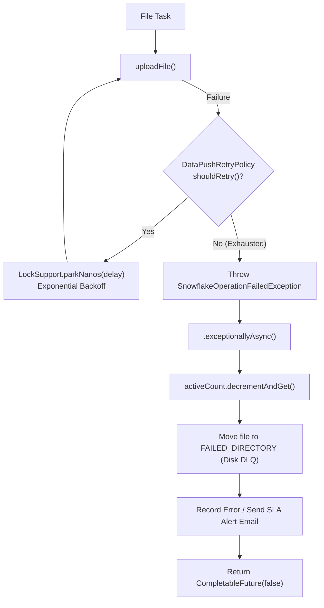

# Snowflake Ingestion Pipeline, Concurrency Architecture & Data Flow

## 1. Executive Summary & Project Overview

This project is a high-throughput **Snowflake Streaming and Ingestion Adapter** built for the **S&P Global N6 Platform**. Its core responsibility is:
1. Ingesting real-time streaming data, batch uploads, historical backfills, and time-series financial datasets.
2. Staging data into compressed files (Parquet / GZ / JSON) on disk.
3. Concurrently uploading staged files to Snowflake internal staging areas (S3 / Azure Blob / GCS).
4. Executing asynchronous `COPY INTO` commands to load staged data into physical tables.
5. Performing in-database incremental merges, updates, and deletes.
6. Generating and maintaining **Secure Views** with row-level security and **Snowflake Secure Data Sharing** to external client accounts.

---

## 2. Concurrency Architecture & Data Structures Inventory

The codebase uses Java concurrent APIs across threading, locking, memory barriers, and synchronization:

| Category | API / Data Structure | Key Locations in Codebase | Purpose & Architecture Role |
| :--- | :--- | :--- | :--- |
| **Bounded Queue** | [`ArrayBlockingQueue<Runnable>`](file:///Users/komalsharma/Documents/Project_SP/src/util/ThreadPoolUtils.java#L43) | [`ThreadPoolUtils.java`](file:///Users/komalsharma/Documents/Project_SP/src/util/ThreadPoolUtils.java#L43) | Bounded work queue backing executors to prevent heap exhaustion. |
| **Concurrent Maps** | [`ConcurrentHashMap<K, V>`](file:///Users/komalsharma/Documents/Project_SP/src/cache/NamespaceCache.java#L43)<br>[`ConcurrentMap<K, V>`](file:///Users/komalsharma/Documents/Project_SP/src/cache/TimeSeriesPartitionCache.java#L42) | [`NamespaceCache`](file:///Users/komalsharma/Documents/Project_SP/src/cache/NamespaceCache.java), [`StreamAfterCache`](file:///Users/komalsharma/Documents/Project_SP/src/cache/StreamAfterCache.java), [`StreamBackFillCache`](file:///Users/komalsharma/Documents/Project_SP/src/cache/StreamBackFillCache.java), [`AbstractDataPublisher`](file:///Users/komalsharma/Documents/Project_SP/src/push/AbstractDataPublisher.java) | Thread-safe in-memory caching of metadata, cursors (`after`), active partition states, and entity executors. |
| **Executors & Pools** | [`ThreadPoolExecutor`](file:///Users/komalsharma/Documents/Project_SP/src/main/TimeSeriesManager.java#L391)<br>`N6ThreadPoolExecutor`<br>`ExecutorServiceProvider` | [`AbstractDataPublisher.java`](file:///Users/komalsharma/Documents/Project_SP/src/push/AbstractDataPublisher.java#L510-L528), [`TimeSeriesManager.java`](file:///Users/komalsharma/Documents/Project_SP/src/main/TimeSeriesManager.java#L346-L352) | Custom thread pools scaled and governed by platform thread policies. |
| **Atomics & Counters** | [`AtomicLong`](file:///Users/komalsharma/Documents/Project_SP/src/push/AbstractDataPublisher.java#L99)<br>[`AtomicBoolean`](file:///Users/komalsharma/Documents/Project_SP/src/cache/data/TimeSeriesPartitionData.java#L35)<br>[`AtomicInteger`](file:///Users/komalsharma/Documents/Project_SP/src/content/FileStats.java#L29)<br>[`AtomicReference<V>`](file:///Users/komalsharma/Documents/Project_SP/src/connection/SnowFlakeConnectionProvider.java#L60) | [`SnowflakeService.java`](file:///Users/komalsharma/Documents/Project_SP/src/push/service/snowflake/SnowflakeService.java#L264), [`TimeSeriesPartitionData.java`](file:///Users/komalsharma/Documents/Project_SP/src/cache/data/TimeSeriesPartitionData.java#L40-L47), [`TimeSeriesManager.java`](file:///Users/komalsharma/Documents/Project_SP/src/main/TimeSeriesManager.java#L363) | Lock-free lifecycle flags (`started`, `active`), in-flight file tracking (`activeCount`), and thread-safe reference coordination. |
| **High-Perf Counters** | [`LongAccumulator`](file:///Users/komalsharma/Documents/Project_SP/src/content/stats/NamespaceStatsProvider.java#L36) | [`NamespaceStatsProvider.java`](file:///Users/komalsharma/Documents/Project_SP/src/content/stats/NamespaceStatsProvider.java) | Contention-free min/max latency metric accumulation across high-throughput threads. |
| **Explicit Locks** | [`ReentrantLock`](file:///Users/komalsharma/Documents/Project_SP/src/push/datablock/DataBlock.java#L59) | [`DataBlock.java`](file:///Users/komalsharma/Documents/Project_SP/src/push/datablock/DataBlock.java#L59), [`DictionaryProvider.java`](file:///Users/komalsharma/Documents/Project_SP/src/retriever/DictionaryProvider.java#L80) | Fair locks protecting chunk buffering and atomic metadata migrations. |
| **Read/Write Locks** | [`ReentrantReadWriteLock`](file:///Users/komalsharma/Documents/Project_SP/src/cache/NamespaceCache.java#L44) | [`NamespaceCache.java`](file:///Users/komalsharma/Documents/Project_SP/src/cache/NamespaceCache.java#L44), [`DictionaryProvider.java`](file:///Users/komalsharma/Documents/Project_SP/src/retriever/DictionaryProvider.java#L81-L82), [`StreamService.java`](file:///Users/komalsharma/Documents/Project_SP/src/persistence/service/StreamService.java#L82) | Allows concurrent reads during data pushing; forces exclusive write lock during schema evolution or entity drops. |
| **Thread Parking** | [`LockSupport.parkNanos()`](file:///Users/komalsharma/Documents/Project_SP/src/push/AbstractDataPublisher.java#L352) | [`AbstractDataPublisher.java`](file:///Users/komalsharma/Documents/Project_SP/src/push/AbstractDataPublisher.java#L352), [`SnowflakeService.java`](file:///Users/komalsharma/Documents/Project_SP/src/push/service/snowflake/SnowflakeService.java#L563), [`MergeManager.java`](file:///Users/komalsharma/Documents/Project_SP/src/main/MergeManager.java#L102) | Non-allocating precision sleep used for exponential backoff and waiting on pipeline flushes. |
| **Barrier Sync** | [`CountDownLatch`](file:///Users/komalsharma/Documents/Project_SP/src/recovery/FailoverGroupManager.java#L156) | [`FailoverGroupManager.java`](file:///Users/komalsharma/Documents/Project_SP/src/recovery/FailoverGroupManager.java#L156), [`StreamManager.java`](file:///Users/komalsharma/Documents/Project_SP/src/main/StreamManager.java#L197), [`TimeSeriesManager.java`](file:///Users/komalsharma/Documents/Project_SP/src/main/TimeSeriesManager.java#L363) | Barrier synchronization for multi-region failover replication and coordinated startup/shutdown. |
| **Async Pipelines** | [`CompletableFuture<T>`](file:///Users/komalsharma/Documents/Project_SP/src/push/service/snowflake/SnowflakeService.java#L317-L341) | [`SnowflakeService.java`](file:///Users/komalsharma/Documents/Project_SP/src/push/service/snowflake/SnowflakeService.java#L317), [`AbstractDataPublisher.java`](file:///Users/komalsharma/Documents/Project_SP/src/push/AbstractDataPublisher.java#L379) | Non-blocking assembly line linking file upload $\to$ Snowflake copy $\to$ metric decrement $\to$ error isolation. |
| **Monitors** | `synchronized` keyword | [`StreamBackFillCache.java`](file:///Users/komalsharma/Documents/Project_SP/src/cache/StreamBackFillCache.java), [`SnowFlakeConnectionProvider.java`](file:///Users/komalsharma/Documents/Project_SP/src/connection/SnowFlakeConnectionProvider.java#L237), [`AbstractDataPublisher.java`](file:///Users/komalsharma/Documents/Project_SP/src/push/AbstractDataPublisher.java#L199) | Coarse-grained mutual exclusion guarding shared cache instances, connections, and batch publisher state. |

---

## 3. Deep Dive: `ArrayBlockingQueue` in the Ingestion Pipeline

### Central Factory Configuration
In [`ThreadPoolUtils.java`](file:///Users/komalsharma/Documents/Project_SP/src/util/ThreadPoolUtils.java#L36-L46):

```java
public static ThreadPoolConfiguration createThreadPoolConfig(IntegerConfig maxParallel,
                                                              IntegerConfig maxQueueSize) {
    final ThreadPoolConfiguration requestPoolConfig = new ThreadPoolConfiguration();
    requestPoolConfig.setMaximumPoolSize(maxParallel);
    requestPoolConfig.setRejectedExecutionHandler(new ForceQueuePolicy());
    final ArrayBlockingQueue<Runnable> queue = new ArrayBlockingQueue<>(maxQueueSize.get());
    requestPoolConfig.setQueue(queue);
    return requestPoolConfig;
}
```

### Why `ArrayBlockingQueue`?
1. **Pre-allocated Circular Array**: Unlike `LinkedBlockingQueue` (which allocates a new `Node` wrapper object on the heap for every single task, causing GC churn), `ArrayBlockingQueue` allocates a single fixed-size array (`Object[]`) upfront.
2. **Strictly Bounded Capacity**: Prevents Out-Of-Memory (OOM) errors by strictly capping how many tasks can be queued before applying backpressure.
3. **Lock & Condition Signaling**: Internal `ReentrantLock` with two conditions (`notFull` and `notEmpty`) enables OS-level thread parking and waking without busy-waiting (0% CPU when blocked).

---

## 4. The 2-Stage Assembly Line Pipeline

In [`AbstractDataPublisher.java`](file:///Users/komalsharma/Documents/Project_SP/src/push/AbstractDataPublisher.java#L510-L528), two separate thread pools are maintained **per entity**:
* `uploadToStagingExecutorMap`: Manages file transfers to Snowflake internal staging.
* `copyIntoSnowflakeExecutorMap`: Manages SQL execution of `COPY INTO <table>`.



### How `CompletableFuture` Operates (Per-File vs. All-Files)
Inside [`SnowflakeService.uploadAndCopyToSnowflakeAsync()`](file:///Users/komalsharma/Documents/Project_SP/src/push/service/snowflake/SnowflakeService.java#L317-L341):
```java
return CompletableFuture
        // STAGE 1: Uploads THIS specific file
        .supplyAsync(() -> uploadFile(dataInfo.key(), stageName, fileWrapper, info),
                     uploadFileExecutor)
        // STAGE 2: Immediately chains to COPY INTO as soon as THIS file upload finishes
        .thenApplyAsync((uploadSuccess) -> {
            if (uploadSuccess) {
                return copyStagedFileToTable(fileWrapper, dataInfo, stageName, fileFormat, info, batchEventPair, publishInitiationTime);
            } else {
                throw new SnowflakeOperationFailedException("File Upload failed", MessageProcessingPhase.FILE_UPLOAD_TO_SNOWFLAKE);
            }
        }, copyFileDataExecutor)
        // STAGE 3: Completion & Counter Decrement
        .thenApplyAsync((copySuccess) -> {
            if (copySuccess) {
                activeCount.decrementAndGet();
                dataFilesStatusService.removeDataFilesStatus(fileWrapper.file());
                return true;
            } else {
                throw new SnowflakeOperationFailedException("File Copy failed", MessageProcessingPhase.COPY_COMMAND_EXECUTION_AT_SNOWFLAKE);
            }
        })
        .exceptionallyAsync((ex) -> {
            activeCount.decrementAndGet();
            handleFileFailure(dataInfo, fileWrapper, info, batchEventPair, ex, MessageProcessingPhase.UNKNOWN);
            dataFilesStatusService.removeDataFilesStatus(fileWrapper.file());
            return false;
        });
```

* **Independent Pipelines**: The pipeline does **not** wait for all files to finish Stage 1 before starting Stage 2. As soon as `File 1` completes uploading, it is submitted to the copy executor, while `File 2` begins uploading concurrently on an upload worker.
* **Batch Barrier**: Waiting for *all* files only occurs at the end of a batch cycle in [`AbstractDataPublisher.publishBatch()`](file:///Users/komalsharma/Documents/Project_SP/src/push/AbstractDataPublisher.java#L379) via `CompletableFuture.allOf(futureList.toArray(new CompletableFuture[]{})).join()`.

---

## 5. Backpressure Mechanism: `ForceQueuePolicy` & Thread Halted States

### What is `ForceQueuePolicy`?
Standard JDK rejection policies either crash the pipeline (`AbortPolicy`) or drop tasks (`DiscardPolicy`), which causes data loss. 

`ForceQueuePolicy` implements backpressure by forcing the submitting thread to wait until space is free:

```java
public class ForceQueuePolicy implements RejectedExecutionHandler {
    @Override
    public void rejectedExecution(Runnable r, ThreadPoolExecutor executor) {
        if (!executor.isShutdown()) {
            try {
                // BLOCKS the submitting thread until space opens up in the ArrayBlockingQueue
                executor.getQueue().put(r);
            } catch (InterruptedException e) {
                Thread.currentThread().interrupt();
                throw new RejectedExecutionException("Interrupted while waiting for queue slot", e);
            }
        }
    }
}
```

### Detailed Execution Mechanics: How the Calling Thread Halts
1. **Who calls it?** The thread attempting to submit the task (e.g. `main` thread or an upload worker thread chaining via `.thenApplyAsync`).
2. **Inside JDK `ArrayBlockingQueue.put(e)`**:
   ```java
   public void put(E e) throws InterruptedException {
       final ReentrantLock lock = this.lock;
       lock.lockInterruptibly();
       try {
           while (count == items.length) {
               notFull.await(); // <--- Calling thread halted here by OS kernel
           }
           enqueue(e);
       } finally {
           lock.unlock();
       }
   }
   ```
3. **OS Kernel State Change**: When `notFull.await()` is called, the OS transitions the thread from `RUNNABLE` to **`WAITING`** and deschedules it from the CPU core (consuming 0% CPU).
4. **Waking Up**: Once a worker thread finishes a task, it dequeues an element and calls `notFull.signal()`. The OS kernel re-schedules the halted thread to `RUNNABLE`, deposits the task, and resumes execution.

### The Cascading Backpressure Chain
```
Snowflake SQL queries slow down (e.g., Warehouse contention)
       │
       ▼
CopyQueue fills up to capacity (e.g., 2 items)
       │
       ▼
Upload Workers finish uploading, try to submit to CopyPool, hit ForceQueuePolicy
       │
       ▼
Upload Workers block on copyQueue.put() and go to sleep
       │
       ▼
UploadQueue fills up to capacity (e.g., 2 items)
       │
       ▼
Main Ingestion Thread tries to submit new chunk, hits ForceQueuePolicy
       │
       ▼
Main Ingestion Thread blocks on uploadQueue.put() and halts reading from source!
```

---

## 6. In-Flight Tracking & Observability

### `activeCount` vs. `executor.getActiveCount()`
* `executor.getActiveCount()` only counts threads actively running inside that pool at that exact microsecond. It does not account for files that finished upload and are waiting in the queue for the copy stage.
* [`activeCount`](file:///Users/komalsharma/Documents/Project_SP/src/push/AbstractDataPublisher.java#L99) (`AtomicLong`) tracks the **entire lifecycle** of a file from disk generation $\to$ staging upload $\to$ SQL copy $\to$ disk cleanup.
* Before flush jobs or shutdowns complete, [`AbstractDataPublisher.java`](file:///Users/komalsharma/Documents/Project_SP/src/push/AbstractDataPublisher.java#L351-L353) waits until `activeCount.get() == 0`:
  ```java
  while (activeCount.get() > 0) {
      LockSupport.parkNanos(TimeUnit.SECONDS.toNanos(1));
  }
  ```

### Direct Queue Inspection & Remaining Capacity
* In [`AbstractDataPublisher.isAllTasksCompleted()`](file:///Users/komalsharma/Documents/Project_SP/src/push/AbstractDataPublisher.java#L504-L508):
  ```java
  uploadToStagingExecutorMap.get(entity).getActiveCount() == 0 &&
  uploadToStagingExecutorMap.get(entity).getQueue().size() == 0 &&
  copyIntoSnowflakeExecutorMap.get(entity).getActiveCount() == 0 &&
  copyIntoSnowflakeExecutorMap.get(entity).getQueue().size() == 0;
  ```
* `queue.remainingCapacity()` returns the number of additional items the queue can accept before blocking (`capacity - size()`).

---

## 7. Failure Handling, Retries & Dead-Letter Isolation



1. **In-Place Retry with Backoff**:
   Both [`uploadFile()`](file:///Users/komalsharma/Documents/Project_SP/src/push/service/snowflake/SnowflakeService.java#L349-L373) and [`copyStagedFileToTable()`](file:///Users/komalsharma/Documents/Project_SP/src/push/service/snowflake/SnowflakeService.java#L375-L468) execute inside `do { ... } while(retry);` loops using `LockSupport.parkNanos(delay)` for non-allocating exponential backoff.
2. **Circuit Breaking to `.exceptionallyAsync()`**:
   If retries exhaust, `SnowflakeOperationFailedException` is thrown. The subsequent stage is skipped, and control jumps straight to `.exceptionallyAsync()`.
3. **Disk Dead-Letter Queue (DLQ)**:
   Inside [`handleFileFailure()`](file:///Users/komalsharma/Documents/Project_SP/src/push/service/snowflake/SnowflakeService.java#L509-L545), the corrupted or failed file is physically moved to `DATAFILES_DIRECTORY_NAME/FAILED_DIRECTORY_NAME/<namespace>/` so it does not block the pipeline.
4. **SLA & Batch Tracking**:
   The entity status is flagged as `false` in `BatchProgressTracker`, an alert email is dispatched via `checkManager.recordAdapterServiceIssueInEmail()`, and the `activeCount` is decremented to prevent pipeline stall.

---

## 8. Backfill Retrieval & TimeSeries Cancellation

### Parallel Backfill Retrieval
In [`StreamBackFillDataRetriever.java`](file:///Users/komalsharma/Documents/Project_SP/src/retriever/StreamBackFillDataRetriever.java#L208-L216):
```java
this.retrievalExecutorService = executorServiceProvider.newCachedThreadPool(
        StreamBackFillDataRetriever.class,
        "Executor service for parallel backfill with stream data retrieval for " + key,
        ThreadPoolUtils.createThreadPoolConfig(
                new IntegerConfig(parallelRetrievalThreads),
                new IntegerConfig(parallelRetrievalThreads)));
```
* Bounding both `maxParallel` and `maxQueueSize` to `parallelRetrievalThreads` ensures that when backfilling hundreds of historical partitions, at most $2 \times \text{parallelRetrievalThreads}$ partition buffers exist in memory at once.

### TimeSeries Partition Cancellation (`getQueue().clear()`)
In [`TimeSeriesManager.java`](file:///Users/komalsharma/Documents/Project_SP/src/main/TimeSeriesManager.java#L388-L393):
```java
ExecutorService executorService = timeSeriesToExecutors.get(timeSeriesKey);
if (executorService != null) {
    ((ThreadPoolExecutor) executorService).getQueue().clear(); // Direct ArrayBlockingQueue drain
    executorService.shutdownNow();
}
```
* **Why `queue.clear()`?** Draining the `ArrayBlockingQueue` instantly removes references to pending data chunks, enabling the garbage collector to reclaim heap buffers immediately without waiting for worker threads to finish active cycles.

---

## 9. Architectural Comparison: Imperative vs. Reactive vs. Virtual Threads

| Dimension | Current Project Model (`ArrayBlockingQueue` + `ForceQueuePolicy`) | Reactive Streams Model (Project Reactor `Flux`) | Java 21 Virtual Threads (Project Loom) |
| :--- | :--- | :--- | :--- |
| **Backpressure Mechanism** | **Push & Block**: Calling thread halts in OS `WAITING` state via `notFull.await()`. | **Pull / Demand-driven**: Consumer signals demand via `request(n)` / `limitRate(10)`. | **Push & Unmount**: Virtual thread halts, unmounting from OS carrier thread. |
| **Thread Resource Impact** | Heavy OS thread stack (~1MB per thread). High thread counts limit scalability. | Minimal stack footprint; non-blocking event-loop model. | Extremely light (~few KB per virtual thread); millions can exist simultaneously. |
| **Deadlock Vulnerability** | Higher risk if upstream thread pool workers block while submitting to downstream pools. | Immune to cross-pool queue deadlock because operations yield execution rather than blocking. | Low risk because carrier threads are never blocked by sleeping virtual threads. |
| **Implementation Complexity** | Medium (straightforward imperative code, manual queue sizing). | Higher (requires understanding reactive functional chains, scheduling, and error signals). | Lowest (imperative code syntax remains intact without OS thread starvation). |

---

## 10. Data Consumption: Does this App Query the Saved Data?

### The Codebase is Push-Only
Analysis of all SQL executions shows **no business data is ever queried or read back into Java memory**.
* `SnowFlakeConnection.executeQuery()` is only invoked for:
  1. `DESC TABLE`, `DESC SCHEMA`, `DESC VIEW`, `DESC SHARE`, `SHOW STREAMS`, `SHOW USER FUNCTIONS` (schema reflection).
  2. `SHOW FAILOVER GROUPS`, `ALTER FAILOVER GROUP ... REFRESH` (replication).
  3. `select MESSAGETYPE from <stream> limit 1` (health check in [`SchemaGenerator.java`](file:///Users/komalsharma/Documents/Project_SP/src/schema/SchemaGenerator.java#L159)).
  4. Executing `MERGE INTO` SQL commands directly inside Snowflake.

### How Data is Actually Consumed
Data is exposed externally using **Snowflake Secure Data Sharing** and **ePass Entitlements**:

```
[Project_SP Adapter]
       │  (Ingest via COPY INTO & MERGE INTO)
       ▼
[Physical Tables: _HISTORY, _LATEST, _TIMESERIES]
       │
       ▼
[Secure Views with Row/Column Entitlements]  <── Managed by ViewGenerator.java
       │                                         & EPassEntitlementManager.java
       ▼
[Snowflake Share]  <── Managed by SnowflakeShareManager.java
       │               (ALTER SHARE ... SET ACCOUNT = <client_account>)
       ▼
[Client Snowflake Accounts (S&P External Customers)]
(Financial Institutions, Hedge Funds, Analysts querying views directly with their own compute)
```

The adapter acts as a **data publisher and sharing orchestrator**, while end users query the secure views directly in their own Snowflake accounts.
